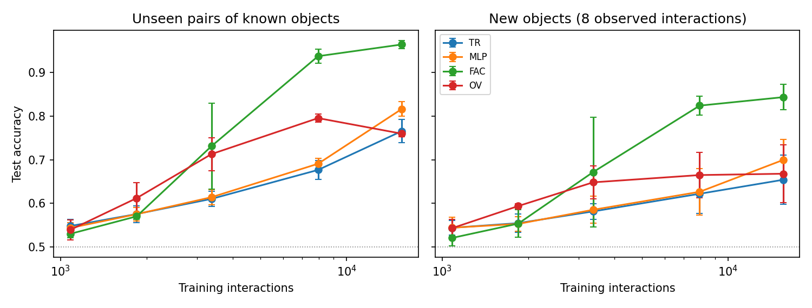
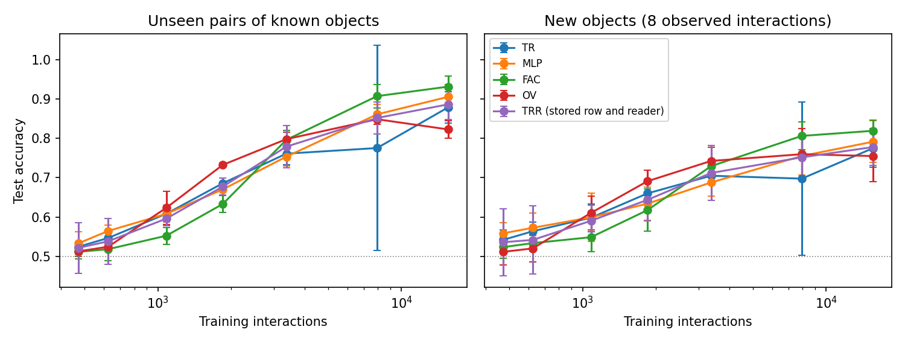
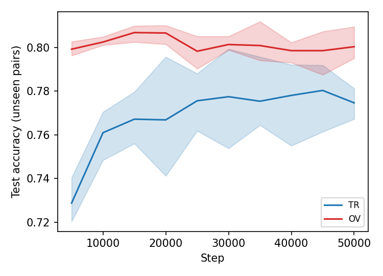

# Automatic report

## Tuning (mean validation accuracy, seed 100)

| Model | wd | d | val |
|---|---|---|---|
| TR | 0.001 |  | 0.715 |
| TR | 0.01 |  | 0.717 |
| TR | 0.1 |  | 0.750 |
| MLP | 0.001 |  | 0.699 |
| MLP | 0.01 |  | 0.701 |
| MLP | 0.1 |  | 0.743 |
| FAC | 0.001 | 8 | 0.728 |
| FAC | 0.001 | 32 | 0.664 |
| FAC | 0.01 | 8 | 0.729 |
| FAC | 0.01 | 32 | 0.673 |
| FAC | 0.1 | 8 | 0.773 |
| FAC | 0.1 | 32 | 0.749 |
| OV | 0.001 |  | 0.777 |
| OV | 0.01 |  | 0.771 |
| OV | 0.1 |  | 0.768 |
| TRR | 0.001 |  | 0.728 |
| TRR | 0.01 |  | 0.720 |
| TRR | 0.1 |  | 0.748 |

## World bilineal

**train** (mean ± 95% CI)

| p | n | TR | MLP | FAC | OV |
|---|---|---|---|---|---|
| 0.005 | 1083 | 1.000 ± 0.000 | 1.000 ± 0.000 | 1.000 ± 0.000 | 1.000 ± 0.000 |
| 0.01 | 1846 | 1.000 ± 0.000 | 1.000 ± 0.000 | 1.000 ± 0.000 | 0.999 ± 0.005 |
| 0.02 | 3372 | 1.000 ± 0.000 | 1.000 ± 0.000 | 1.000 ± 0.000 | 0.997 ± 0.002 |
| 0.05 | 7952 | 0.998 ± 0.004 | 1.000 ± 0.000 | 1.000 ± 0.001 | 0.904 ± 0.006 |
| 0.1 | 15584 | 0.995 ± 0.006 | 1.000 ± 0.000 | 0.995 ± 0.004 | 0.774 ± 0.028 |

**test_par** (mean ± 95% CI)

| p | n | TR | MLP | FAC | OV |
|---|---|---|---|---|---|
| 0.005 | 1083 | 0.548 ± 0.015 | 0.543 ± 0.012 | 0.530 ± 0.008 | 0.539 ± 0.023 |
| 0.01 | 1846 | 0.575 ± 0.019 | 0.575 ± 0.015 | 0.570 ± 0.007 | 0.612 ± 0.035 |
| 0.02 | 3372 | 0.610 ± 0.018 | 0.614 ± 0.018 | 0.731 ± 0.098 | 0.713 ± 0.038 |
| 0.05 | 7952 | 0.676 ± 0.022 | 0.691 ± 0.012 | 0.938 ± 0.016 | 0.796 ± 0.009 |
| 0.1 | 15584 | 0.766 ± 0.027 | 0.816 ± 0.017 | 0.965 ± 0.009 | 0.760 ± 0.008 |

**test_obj** (mean ± 95% CI)

| p | n | TR | MLP | FAC | OV |
|---|---|---|---|---|---|
| 0.005 | 1083 | 0.544 ± 0.016 | 0.544 ± 0.024 | 0.520 ± 0.018 | 0.543 ± 0.021 |
| 0.01 | 1846 | 0.554 ± 0.021 | 0.552 ± 0.017 | 0.553 ± 0.032 | 0.593 ± 0.006 |
| 0.02 | 3372 | 0.581 ± 0.018 | 0.585 ± 0.031 | 0.671 ± 0.126 | 0.648 ± 0.038 |
| 0.05 | 7952 | 0.622 ± 0.045 | 0.626 ± 0.054 | 0.824 ± 0.022 | 0.665 ± 0.052 |
| 0.1 | 15584 | 0.654 ± 0.056 | 0.699 ± 0.047 | 0.844 ± 0.029 | 0.668 ± 0.067 |

- Ratio n_TR(ε)/n_OV(ε), test_par (0 = OV does not reach ε): geometric mean 2.67, bootstrap CI [2.54, 2.75], by seed [2.75, 2.72, 2.54]
- Ratio n_TR(ε)/n_MLP(ε), test_par (0 = MLP does not reach ε): geometric mean 1.31, bootstrap CI [1.28, 1.36], by seed [1.3, 1.36, 1.28]
- Ratio n_TR(ε)/n_OV(ε), test_obj (0 = OV does not reach ε): geometric mean nan, bootstrap CI [nan, nan], by seed [4.49, 4.9, 0.0]
- Ratio n_TR(ε)/n_MLP(ε), test_obj (0 = MLP does not reach ε): geometric mean 1.53, bootstrap CI [1.42, 1.61], by seed [1.61, 1.56, 1.42]
- (post hoc) n_TR/n_OV for accuracy 0.70, test_par, by seed: [3.06, 2.92, 3.09]
- (post hoc) n_TR/n_OV for accuracy 0.75, test_par, by seed: [2.89, 2.74, 2.85]
- (post hoc) n_TR/n_OV for accuracy 0.80, test_par, by seed: [None, None, None]
- (post hoc) n_TR/n_OV for accuracy 0.70, test_obj, by seed: [None, None, None]
- (post hoc) n_TR/n_OV for accuracy 0.75, test_obj, by seed: [None, None, None]
- (post hoc) n_TR/n_OV for accuracy 0.80, test_obj, by seed: [None, None, None]

**(additional) ρ(n) = n_TR(ε_OV(n)) / n, test_par** (> lower bound: TR does not reach that error; < upper bound)

| p | n | by seed | geometric mean |
|---|---|---|---|
| 0.005 | 1083 | 1.03, <1.00, <1.00 | with bounds |
| 0.01 | 1846 | 1.47, 1.94, 2.18 | 1.84 |
| 0.02 | 3372 | 3.21, 2.94, 3.17 | 3.10 |
| 0.05 | 7952 | >1.96, >1.96, >1.96 | with bounds |
| 0.1 | 15584 | 0.95, >1.00, 0.87 | with bounds |

**(additional) ρ(n) = n_TR(ε_MLP(n)) / n, test_par** (> lower bound: TR does not reach that error; < upper bound)

| p | n | by seed | geometric mean |
|---|---|---|---|
| 0.005 | 1083 | <1.00, <1.00, 1.06 | with bounds |
| 0.01 | 1846 | 1.07, 1.02, 0.91 | 1.00 |
| 0.02 | 3372 | 0.87, 1.20, 1.08 | 1.04 |
| 0.05 | 7952 | 1.09, 1.16, 1.09 | 1.11 |
| 0.1 | 15584 | >1.00, >1.00, >1.00 | with bounds |

**(additional) ρ(n) = n_TR(ε_OV(n)) / n, test_obj** (> lower bound: TR does not reach that error; < upper bound)

| p | n | by seed | geometric mean |
|---|---|---|---|
| 0.005 | 1083 | 1.22, <1.00, <1.00 | with bounds |
| 0.01 | 1846 | 1.95, 3.57, 2.33 | 2.53 |
| 0.02 | 3372 | 4.55, >4.62, 3.18 | with bounds |
| 0.05 | 7952 | >1.96, >1.96, 1.80 | with bounds |
| 0.1 | 15584 | >1.00, >1.00, 0.83 | with bounds |

**(additional) ρ(n) = n_TR(ε_MLP(n)) / n, test_obj** (> lower bound: TR does not reach that error; < upper bound)

| p | n | by seed | geometric mean |
|---|---|---|---|
| 0.005 | 1083 | 1.39, <1.00, 1.19 | with bounds |
| 0.01 | 1846 | 0.93, 0.70, 1.00 | 0.87 |
| 0.02 | 3372 | 0.77, 0.98, 1.42 | 1.02 |
| 0.05 | 7952 | 1.37, 1.05, 0.95 | 1.11 |
| 0.1 | 15584 | >1.00, >1.00, >1.00 | with bounds |

**(additional) Probes by size** (mean ± 95% CI over seeds)

| p | Model | R² z linear | R² control linear |
|---|---|---|---|
| 0.005 | TR | -0.003 ± 0.017 | -0.007 ± 0.005 |
| 0.005 | MLP | -0.001 ± 0.042 | -0.007 ± 0.005 |
| 0.005 | FAC | 0.035 ± 0.079 | -0.010 ± 0.003 |
| 0.005 | OV | 0.041 ± 0.038 | -0.012 ± 0.010 |
| 0.01 | TR | -0.000 ± 0.010 | -0.007 ± 0.010 |
| 0.01 | MLP | 0.014 ± 0.037 | -0.007 ± 0.009 |
| 0.01 | FAC | 0.136 ± 0.057 | -0.009 ± 0.008 |
| 0.01 | OV | 0.212 ± 0.039 | -0.019 ± 0.029 |
| 0.02 | TR | 0.004 ± 0.053 | -0.008 ± 0.007 |
| 0.02 | MLP | 0.058 ± 0.094 | -0.008 ± 0.007 |
| 0.02 | FAC | 0.521 ± 0.317 | -0.007 ± 0.010 |
| 0.02 | OV | 0.442 ± 0.113 | -0.020 ± 0.023 |
| 0.05 | TR | 0.133 ± 0.120 | -0.008 ± 0.006 |
| 0.05 | MLP | 0.276 ± 0.209 | -0.008 ± 0.006 |
| 0.05 | FAC | 0.839 ± 0.044 | -0.007 ± 0.024 |
| 0.05 | OV | 0.621 ± 0.086 | -0.017 ± 0.052 |
| 0.1 | TR | 0.302 ± 0.156 | -0.008 ± 0.007 |
| 0.1 | MLP | 0.559 ± 0.097 | -0.009 ± 0.004 |
| 0.1 | FAC | 0.853 ± 0.048 | -0.007 ± 0.023 |
| 0.1 | OV | 0.640 ± 0.088 | -0.019 ± 0.020 |

**Probes and intervention** (mean ± 95% CI over seeds and sizes)

| Model | R² z | R² control | accuracy edited world | accuracy original world | fraction that changes |
|---|---|---|---|---|---|
| TR | 0.087 ± 0.070 | -0.008 ± 0.001 | 0.590 ± 0.027 | 0.609 ± 0.037 | 0.427 ± 0.013 |
| MLP | 0.181 ± 0.124 | -0.008 ± 0.001 | 0.619 ± 0.045 | 0.592 ± 0.029 | 0.427 ± 0.013 |
| FAC | 0.477 ± 0.198 | -0.008 ± 0.003 | 0.713 ± 0.091 | 0.584 ± 0.032 | 0.427 ± 0.013 |
| OV | 0.391 ± 0.135 | -0.017 ± 0.006 | 0.680 ± 0.062 | 0.599 ± 0.024 | 0.427 ± 0.013 |

## World mlp

**train** (mean ± 95% CI)

| p | n | TR | MLP | FAC | OV | TRR |
|---|---|---|---|---|---|---|
| 0.001 | 472 | 1.000 ± 0.000 | 1.000 ± 0.000 | 1.000 ± 0.000 | 1.000 ± 0.000 | 1.000 ± 0.000 |
| 0.002 | 625 | 1.000 ± 0.000 | 1.000 ± 0.000 | 1.000 ± 0.000 | 1.000 ± 0.000 | 1.000 ± 0.000 |
| 0.005 | 1083 | 1.000 ± 0.000 | 1.000 ± 0.000 | 1.000 ± 0.000 | 0.999 ± 0.004 | 1.000 ± 0.000 |
| 0.01 | 1846 | 1.000 ± 0.000 | 1.000 ± 0.000 | 1.000 ± 0.000 | 0.999 ± 0.000 | 1.000 ± 0.000 |
| 0.02 | 3372 | 1.000 ± 0.000 | 1.000 ± 0.000 | 1.000 ± 0.000 | 0.995 ± 0.004 | 0.999 ± 0.003 |
| 0.05 | 7952 | 0.898 ± 0.424 | 1.000 ± 0.000 | 0.991 ± 0.013 | 0.941 ± 0.014 | 1.000 ± 0.000 |
| 0.1 | 15584 | 0.998 ± 0.004 | 1.000 ± 0.000 | 0.972 ± 0.014 | 0.838 ± 0.022 | 0.999 ± 0.005 |

**test_par** (mean ± 95% CI)

| p | n | TR | MLP | FAC | OV | TRR |
|---|---|---|---|---|---|---|
| 0.001 | 472 | 0.524 ± 0.011 | 0.533 ± 0.029 | 0.511 ± 0.017 | 0.513 ± 0.014 | 0.522 ± 0.064 |
| 0.002 | 625 | 0.547 ± 0.015 | 0.564 ± 0.016 | 0.518 ± 0.030 | 0.524 ± 0.007 | 0.538 ± 0.058 |
| 0.005 | 1083 | 0.608 ± 0.020 | 0.608 ± 0.022 | 0.552 ± 0.022 | 0.623 ± 0.042 | 0.596 ± 0.017 |
| 0.01 | 1846 | 0.685 ± 0.014 | 0.670 ± 0.014 | 0.633 ± 0.021 | 0.732 ± 0.006 | 0.677 ± 0.021 |
| 0.02 | 3372 | 0.761 ± 0.028 | 0.753 ± 0.023 | 0.796 ± 0.024 | 0.798 ± 0.018 | 0.779 ± 0.053 |
| 0.05 | 7952 | 0.775 ± 0.261 | 0.861 ± 0.026 | 0.907 ± 0.030 | 0.848 ± 0.013 | 0.852 ± 0.041 |
| 0.1 | 15584 | 0.879 ± 0.040 | 0.905 ± 0.031 | 0.931 ± 0.027 | 0.822 ± 0.022 | 0.886 ± 0.038 |

**test_obj** (mean ± 95% CI)

| p | n | TR | MLP | FAC | OV | TRR |
|---|---|---|---|---|---|---|
| 0.001 | 472 | 0.542 ± 0.025 | 0.559 ± 0.027 | 0.523 ± 0.029 | 0.511 ± 0.033 | 0.536 ± 0.085 |
| 0.002 | 625 | 0.564 ± 0.024 | 0.573 ± 0.038 | 0.534 ± 0.020 | 0.520 ± 0.035 | 0.542 ± 0.087 |
| 0.005 | 1083 | 0.598 ± 0.035 | 0.599 ± 0.061 | 0.549 ± 0.037 | 0.610 ± 0.043 | 0.590 ± 0.040 |
| 0.01 | 1846 | 0.660 ± 0.016 | 0.634 ± 0.042 | 0.617 ± 0.054 | 0.691 ± 0.027 | 0.643 ± 0.053 |
| 0.02 | 3372 | 0.705 ± 0.017 | 0.688 ± 0.034 | 0.729 ± 0.017 | 0.742 ± 0.035 | 0.712 ± 0.070 |
| 0.05 | 7952 | 0.697 ± 0.195 | 0.755 ± 0.049 | 0.806 ± 0.035 | 0.760 ± 0.065 | 0.752 ± 0.053 |
| 0.1 | 15584 | 0.775 ± 0.048 | 0.791 ± 0.053 | 0.819 ± 0.027 | 0.755 ± 0.066 | 0.778 ± 0.047 |

- Ratio n_TR(ε)/n_OV(ε), test_par (0 = OV does not reach ε): geometric mean nan, bootstrap CI [nan, nan], by seed [0.0, 0.0, 0.0]
- Ratio n_TR(ε)/n_MLP(ε), test_par (0 = MLP does not reach ε): geometric mean 1.50, bootstrap CI [1.42, 1.64], by seed [1.42, 1.64, 1.45]
- Ratio n_TR(ε)/n_OV(ε), test_obj (0 = OV does not reach ε): geometric mean nan, bootstrap CI [nan, nan], by seed [0.0, 0.0, 0.0]
- Ratio n_TR(ε)/n_MLP(ε), test_obj (0 = MLP does not reach ε): geometric mean 1.36, bootstrap CI [1.16, 1.56], by seed [1.16, 1.39, 1.56]
- (post hoc) n_TR/n_OV for accuracy 0.70, test_par, by seed: [1.21, 1.33, 1.43]
- (post hoc) n_TR/n_OV for accuracy 0.75, test_par, by seed: [1.33, 1.4, 3.67]
- (post hoc) n_TR/n_OV for accuracy 0.80, test_par, by seed: [1.49, 1.46, 2.7]
- (post hoc) n_TR/n_OV for accuracy 0.70, test_obj, by seed: [1.58, 1.47, 1.57]
- (post hoc) n_TR/n_OV for accuracy 0.75, test_obj, by seed: [1.83, None, 3.51]
- (post hoc) n_TR/n_OV for accuracy 0.80, test_obj, by seed: [None, None, None]

**(additional) ρ(n) = n_TR(ε_OV(n)) / n, test_par** (> lower bound: TR does not reach that error; < upper bound)

| p | n | by seed | geometric mean |
|---|---|---|---|
| 0.001 | 472 | <1.00, <1.00, <1.00 | with bounds |
| 0.002 | 625 | <0.76, 0.79, <0.76 | with bounds |
| 0.005 | 1083 | 0.92, 1.19, 1.24 | 1.11 |
| 0.01 | 1846 | 1.34, 1.45, 1.60 | 1.46 |
| 0.02 | 3372 | 1.52, 1.49, 2.92 | 1.88 |
| 0.05 | 7952 | 1.19, 1.40, 1.59 | 1.39 |
| 0.1 | 15584 | 0.44, 0.42, 0.72 | 0.51 |

**(additional) ρ(n) = n_TR(ε_MLP(n)) / n, test_par** (> lower bound: TR does not reach that error; < upper bound)

| p | n | by seed | geometric mean |
|---|---|---|---|
| 0.001 | 472 | 1.36, <1.00, 1.09 | with bounds |
| 0.002 | 625 | 1.25, 1.17, 1.08 | 1.16 |
| 0.005 | 1083 | 0.93, 1.00, 1.07 | 1.00 |
| 0.01 | 1846 | 0.86, 0.88, 0.96 | 0.90 |
| 0.02 | 3372 | 0.87, 0.86, 2.53 | 1.24 |
| 0.05 | 7952 | 1.38, 1.55, 1.77 | 1.56 |
| 0.1 | 15584 | >1.00, >1.00, >1.00 | with bounds |

**(additional) ρ(n) = n_TR(ε_TRR(n)) / n, test_par** (> lower bound: TR does not reach that error; < upper bound)

| p | n | by seed | geometric mean |
|---|---|---|---|
| 0.001 | 472 | 1.43, <1.00, <1.00 | with bounds |
| 0.002 | 625 | 1.16, <0.76, 0.86 | with bounds |
| 0.005 | 1083 | 0.87, 1.02, 0.83 | 0.90 |
| 0.01 | 1846 | 0.97, 0.92, 0.95 | 0.94 |
| 0.02 | 3372 | 1.29, 0.93, 2.87 | 1.51 |
| 0.05 | 7952 | 1.23, 1.11, 1.74 | 1.33 |
| 0.1 | 15584 | >1.00, >1.00, 0.97 | with bounds |

**(additional) ρ(n) = n_TR(ε_OV(n)) / n, test_obj** (> lower bound: TR does not reach that error; < upper bound)

| p | n | by seed | geometric mean |
|---|---|---|---|
| 0.001 | 472 | <1.00, <1.00, <1.00 | with bounds |
| 0.002 | 625 | <0.76, <0.76, <0.76 | with bounds |
| 0.005 | 1083 | 1.02, 1.08, 1.29 | 1.13 |
| 0.01 | 1846 | 1.62, 1.40, 1.51 | 1.51 |
| 0.02 | 3372 | 1.84, 2.80, 3.50 | 2.62 |
| 0.05 | 7952 | 1.66, 1.27, 1.70 | 1.53 |
| 0.1 | 15584 | 0.70, 0.59, 0.85 | 0.70 |

**(additional) ρ(n) = n_TR(ε_MLP(n)) / n, test_obj** (> lower bound: TR does not reach that error; < upper bound)

| p | n | by seed | geometric mean |
|---|---|---|---|
| 0.001 | 472 | 1.31, 1.21, 1.22 | 1.25 |
| 0.002 | 625 | 1.16, 1.04, 1.24 | 1.14 |
| 0.005 | 1083 | 0.95, 0.83, 1.19 | 0.98 |
| 0.01 | 1846 | 0.73, 0.75, 0.99 | 0.81 |
| 0.02 | 3372 | 0.64, 0.75, 2.38 | 1.05 |
| 0.05 | 7952 | 0.89, 1.39, 1.77 | 1.30 |
| 0.1 | 15584 | >1.00, >1.00, >1.00 | with bounds |

**(additional) ρ(n) = n_TR(ε_TRR(n)) / n, test_obj** (> lower bound: TR does not reach that error; < upper bound)

| p | n | by seed | geometric mean |
|---|---|---|---|
| 0.001 | 472 | 1.44, <1.00, <1.00 | with bounds |
| 0.002 | 625 | 1.04, <0.76, 0.84 | with bounds |
| 0.005 | 1083 | 1.00, 0.92, 0.74 | 0.88 |
| 0.01 | 1846 | 1.02, 0.83, 0.77 | 0.87 |
| 0.02 | 3372 | 1.50, 0.75, 2.66 | 1.44 |
| 0.05 | 7952 | 1.20, 1.23, 1.54 | 1.32 |
| 0.1 | 15584 | >1.00, >1.00, 0.94 | with bounds |

**(additional) Probes by size** (mean ± 95% CI over seeds)

| p | Model | R² z linear | R² control linear | R² z kernel | R² control kernel |
|---|---|---|---|---|---|
| 0.001 | TR | -0.008 ± 0.017 | -0.007 ± 0.005 | -0.006 ± 0.013 | -0.004 ± 0.005 |
| 0.001 | MLP | -0.006 ± 0.022 | -0.009 ± 0.009 | -0.008 ± 0.014 | -0.004 ± 0.005 |
| 0.001 | FAC | 0.004 ± 0.001 | -0.010 ± 0.009 | 0.002 ± 0.015 | -0.005 ± 0.011 |
| 0.001 | OV | -0.007 ± 0.008 | -0.011 ± 0.011 | -0.007 ± 0.011 | -0.005 ± 0.011 |
| 0.001 | TRR | -0.011 ± 0.010 | -0.012 ± 0.003 | -0.010 ± 0.012 | -0.006 ± 0.009 |
| 0.002 | TR | -0.006 ± 0.025 | -0.009 ± 0.009 | -0.008 ± 0.015 | -0.004 ± 0.006 |
| 0.002 | MLP | 0.002 ± 0.041 | -0.009 ± 0.010 | -0.003 ± 0.031 | -0.004 ± 0.005 |
| 0.002 | FAC | 0.015 ± 0.045 | -0.011 ± 0.009 | 0.013 ± 0.041 | -0.004 ± 0.012 |
| 0.002 | OV | 0.010 ± 0.041 | -0.008 ± 0.008 | 0.018 ± 0.028 | -0.010 ± 0.011 |
| 0.002 | TRR | -0.006 ± 0.038 | -0.010 ± 0.006 | -0.007 ± 0.024 | -0.007 ± 0.011 |
| 0.005 | TR | -0.004 ± 0.049 | -0.008 ± 0.005 | | |
| 0.005 | MLP | 0.019 ± 0.079 | -0.008 ± 0.005 | | |
| 0.005 | FAC | 0.086 ± 0.025 | -0.011 ± 0.007 | | |
| 0.005 | OV | 0.127 ± 0.221 | -0.013 ± 0.022 | | |
| 0.005 | TRR | 0.028 ± 0.070 | -0.011 ± 0.005 | 0.023 ± 0.066 | -0.006 ± 0.003 |
| 0.01 | TR | 0.017 ± 0.073 | -0.008 ± 0.006 | | |
| 0.01 | MLP | 0.068 ± 0.152 | -0.009 ± 0.013 | | |
| 0.01 | FAC | 0.258 ± 0.051 | -0.007 ± 0.007 | | |
| 0.01 | OV | 0.340 ± 0.124 | -0.031 ± 0.013 | | |
| 0.01 | TRR | 0.072 ± 0.062 | -0.009 ± 0.009 | 0.066 ± 0.048 | -0.005 ± 0.007 |
| 0.02 | TR | 0.091 ± 0.063 | -0.010 ± 0.009 | | |
| 0.02 | MLP | 0.191 ± 0.248 | -0.008 ± 0.009 | | |
| 0.02 | FAC | 0.594 ± 0.084 | -0.007 ± 0.001 | | |
| 0.02 | OV | 0.555 ± 0.105 | -0.015 ± 0.052 | | |
| 0.02 | TRR | 0.228 ± 0.412 | -0.008 ± 0.013 | 0.229 ± 0.404 | -0.004 ± 0.009 |
| 0.05 | TR | 0.243 ± 0.220 | -0.006 ± 0.006 | | |
| 0.05 | MLP | 0.461 ± 0.178 | -0.007 ± 0.011 | | |
| 0.05 | FAC | 0.761 ± 0.093 | -0.005 ± 0.018 | | |
| 0.05 | OV | 0.664 ± 0.093 | -0.008 ± 0.015 | | |
| 0.05 | TRR | 0.325 ± 0.276 | -0.007 ± 0.012 | 0.329 ± 0.264 | -0.008 ± 0.009 |
| 0.1 | TR | 0.368 ± 0.147 | -0.009 ± 0.005 | | |
| 0.1 | MLP | 0.620 ± 0.196 | -0.007 ± 0.008 | | |
| 0.1 | FAC | 0.791 ± 0.053 | -0.007 ± 0.011 | | |
| 0.1 | OV | 0.638 ± 0.118 | -0.012 ± 0.041 | | |
| 0.1 | TRR | 0.455 ± 0.142 | -0.006 ± 0.016 | 0.460 ± 0.142 | -0.005 ± 0.006 |

**Probes and intervention** (mean ± 95% CI over seeds and sizes)

| Model | R² z | R² control | accuracy edited world | accuracy original world | fraction that changes |
|---|---|---|---|---|---|
| TR | 0.143 ± 0.085 | -0.008 ± 0.001 | 0.677 ± 0.041 | 0.667 ± 0.047 | 0.360 ± 0.040 |
| MLP | 0.272 ± 0.137 | -0.008 ± 0.002 | 0.723 ± 0.058 | 0.640 ± 0.037 | 0.360 ± 0.040 |
| FAC | 0.498 ± 0.161 | -0.007 ± 0.002 | 0.744 ± 0.074 | 0.630 ± 0.044 | 0.360 ± 0.040 |
| OV | 0.465 ± 0.120 | -0.016 ± 0.008 | 0.749 ± 0.051 | 0.648 ± 0.038 | 0.360 ± 0.040 |
| TRR | 0.222 ± 0.101 | -0.008 ± 0.002 | 0.708 ± 0.044 | 0.672 ± 0.044 | 0.360 ± 0.040 |

## World par

**train** (mean ± 95% CI)

| p | n | TR | MLP | FAC | OV | TRR |
|---|---|---|---|---|---|---|
| 0.02 | 3372 | 0.854 ± 0.628 | 1.000 ± 0.000 | 0.993 ± 0.002 | 0.997 ± 0.002 | 1.000 ± 0.000 |

**test_par** (mean ± 95% CI)

| p | n | TR | MLP | FAC | OV | TRR |
|---|---|---|---|---|---|---|
| 0.02 | 3372 | 0.502 ± 0.023 | 0.497 ± 0.007 | 0.500 ± 0.017 | 0.493 ± 0.013 | 0.508 ± 0.023 |

**test_obj** (mean ± 95% CI)

| p | n | TR | MLP | FAC | OV | TRR |
|---|---|---|---|---|---|---|
| 0.02 | 3372 | 0.500 ± 0.019 | 0.497 ± 0.017 | 0.498 ± 0.017 | 0.502 ± 0.027 | 0.491 ± 0.021 |

## Long training (H3)

- TR: final test_par 0.775 ± 0.017, train 1.000 ± 0.000
- OV: final test_par 0.800 ± 0.020, train 0.998 ± 0.003

