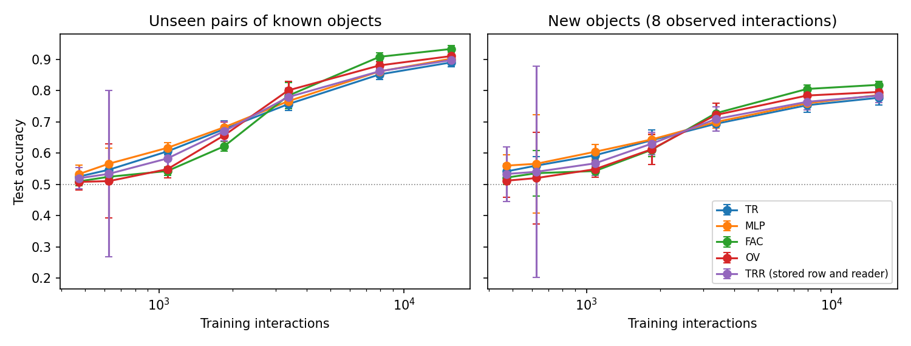
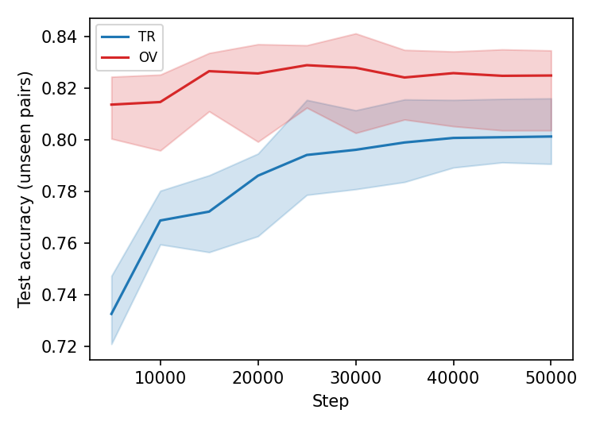

# Automatic report

## Tuning (mean validation accuracy, seed 100)

| Model | wd | d | val |
|---|---|---|---|
| TR | 0.001 |  | 0.712 |
| TR | 0.01 |  | 0.715 |
| TR | 0.1 |  | 0.744 |
| MLP | 0.001 |  | 0.698 |
| MLP | 0.01 |  | 0.703 |
| MLP | 0.1 |  | 0.747 |
| FAC | 0.001 | 8 | 0.727 |
| FAC | 0.001 | 32 | 0.667 |
| FAC | 0.01 | 8 | 0.731 |
| FAC | 0.01 | 32 | 0.677 |
| FAC | 0.1 | 8 | 0.771 |
| FAC | 0.1 | 32 | 0.753 |
| OV | 0.001 |  | 0.779 |
| OV | 0.01 |  | 0.788 |
| OV | 0.1 |  | 0.794 |
| TRR | 0.001 |  | 0.746 |
| TRR | 0.01 |  | 0.755 |
| TRR | 0.1 |  | 0.769 |

## World mlp

**train** (mean ± 95% CI)

| p | n | TR | MLP | FAC | OV | TRR |
|---|---|---|---|---|---|---|
| 0.001 | 472 | 1.000 ± 0.000 | 1.000 ± 0.000 | 1.000 ± 0.000 | 1.000 ± 0.000 | 1.000 ± 0.000 |
| 0.002 | 625 | 1.000 ± 0.000 | 1.000 ± 0.000 | 1.000 ± 0.000 | 1.000 ± 0.000 | 1.000 ± 0.000 |
| 0.005 | 1083 | 1.000 ± 0.000 | 1.000 ± 0.000 | 1.000 ± 0.000 | 1.000 ± 0.000 | 1.000 ± 0.000 |
| 0.01 | 1846 | 1.000 ± 0.000 | 1.000 ± 0.000 | 1.000 ± 0.000 | 1.000 ± 0.000 | 1.000 ± 0.000 |
| 0.02 | 3372 | 1.000 ± 0.000 | 1.000 ± 0.000 | 1.000 ± 0.000 | 1.000 ± 0.000 | 1.000 ± 0.000 |
| 0.05 | 7952 | 1.000 ± 0.000 | 1.000 ± 0.000 | 0.993 ± 0.006 | 1.000 ± 0.000 | 1.000 ± 0.000 |
| 0.1 | 15584 | 1.000 ± 0.000 | 1.000 ± 0.000 | 0.975 ± 0.009 | 0.997 ± 0.001 | 1.000 ± 0.000 |

**test_par** (mean ± 95% CI)

| p | n | TR | MLP | FAC | OV | TRR |
|---|---|---|---|---|---|---|
| 0.001 | 472 | 0.525 ± 0.012 | 0.533 ± 0.029 | 0.510 ± 0.014 | 0.508 ± 0.025 | 0.520 ± 0.034 |
| 0.002 | 625 | 0.547 ± 0.021 | 0.566 ± 0.050 | 0.524 ± 0.017 | 0.510 ± 0.118 | 0.534 ± 0.266 |
| 0.005 | 1083 | 0.605 ± 0.010 | 0.617 ± 0.017 | 0.543 ± 0.014 | 0.549 ± 0.027 | 0.583 ± 0.030 |
| 0.01 | 1846 | 0.677 ± 0.026 | 0.682 ± 0.018 | 0.622 ± 0.015 | 0.657 ± 0.043 | 0.670 ± 0.031 |
| 0.02 | 3372 | 0.756 ± 0.020 | 0.766 ± 0.016 | 0.784 ± 0.042 | 0.800 ± 0.028 | 0.779 ± 0.028 |
| 0.05 | 7952 | 0.851 ± 0.016 | 0.861 ± 0.007 | 0.908 ± 0.014 | 0.880 ± 0.011 | 0.862 ± 0.015 |
| 0.1 | 15584 | 0.890 ± 0.014 | 0.902 ± 0.013 | 0.933 ± 0.011 | 0.910 ± 0.006 | 0.897 ± 0.010 |

**test_obj** (mean ± 95% CI)

| p | n | TR | MLP | FAC | OV | TRR |
|---|---|---|---|---|---|---|
| 0.001 | 472 | 0.542 ± 0.024 | 0.560 ± 0.034 | 0.522 ± 0.022 | 0.512 ± 0.053 | 0.533 ± 0.087 |
| 0.002 | 625 | 0.560 ± 0.029 | 0.566 ± 0.158 | 0.536 ± 0.072 | 0.520 ± 0.146 | 0.540 ± 0.337 |
| 0.005 | 1083 | 0.593 ± 0.014 | 0.604 ± 0.023 | 0.543 ± 0.014 | 0.548 ± 0.026 | 0.567 ± 0.039 |
| 0.01 | 1846 | 0.641 ± 0.034 | 0.644 ± 0.016 | 0.611 ± 0.022 | 0.612 ± 0.049 | 0.630 ± 0.036 |
| 0.02 | 3372 | 0.694 ± 0.024 | 0.699 ± 0.019 | 0.727 ± 0.032 | 0.722 ± 0.037 | 0.709 ± 0.039 |
| 0.05 | 7952 | 0.753 ± 0.023 | 0.759 ± 0.021 | 0.805 ± 0.013 | 0.784 ± 0.020 | 0.764 ± 0.026 |
| 0.1 | 15584 | 0.777 ± 0.022 | 0.786 ± 0.025 | 0.818 ± 0.010 | 0.795 ± 0.007 | 0.784 ± 0.022 |

- Ratio n_TR(ε)/n_OV(ε), test_par (0 = OV does not reach ε): geometric mean 1.59, bootstrap CI [1.41, 1.79], by seed [1.29, 1.97, 1.55, 1.48, 1.75]
- Ratio n_TR(ε)/n_MLP(ε), test_par (0 = MLP does not reach ε): geometric mean 1.22, bootstrap CI [1.11, 1.32], by seed [1.04, 1.31, 1.37, 1.14, 1.26]
- Ratio n_TR(ε)/n_OV(ε), test_obj (0 = OV does not reach ε): geometric mean nan, bootstrap CI [nan, nan], by seed [2.35, 2.07, 2.37, 0.0, 2.33]
- Ratio n_TR(ε)/n_MLP(ε), test_obj (0 = MLP does not reach ε): geometric mean 1.25, bootstrap CI [1.12, 1.39], by seed [1.01, 1.22, 1.49, 1.25, 1.36]
- (post hoc) n_TR/n_OV for accuracy 0.70, test_par, by seed: [0.96, 0.94, 0.97, 0.96, 1.13]
- (post hoc) n_TR/n_OV for accuracy 0.75, test_par, by seed: [1.18, 1.01, 1.32, 1.25, 1.2]
- (post hoc) n_TR/n_OV for accuracy 0.80, test_par, by seed: [1.53, 1.23, 1.39, 1.49, 1.5]
- (post hoc) n_TR/n_OV for accuracy 0.70, test_obj, by seed: [1.17, 1.15, 1.31, 1.08, 1.51]
- (post hoc) n_TR/n_OV for accuracy 0.75, test_obj, by seed: [2.0, 1.99, 1.41, 1.51, 1.76]
- (post hoc) n_TR/n_OV for accuracy 0.80, test_obj, by seed: [None, None, None, None, None]

**(additional) ρ(n) = n_TR(ε_OV(n)) / n, test_par** (> lower bound: TR does not reach that error; < upper bound)

| p | n | by seed | geometric mean |
|---|---|---|---|
| 0.001 | 472 | <1.00, <1.00, <1.00 | with bounds |
| 0.002 | 625 | <0.76, <0.76 | with bounds |
| 0.005 | 1083 | 0.60, 0.51, <0.44, <1.00, <1.00 | with bounds |
| 0.01 | 1846 | 0.88, 0.63, 0.70, 0.95, 1.11 | 0.84 |
| 0.02 | 3372 | 1.76, 1.09, 1.45, 1.58, 1.56 | 1.47 |
| 0.05 | 7952 | 1.35, >1.96, 1.53, 1.66, 1.82 | with bounds |
| 0.1 | 15584 | >1.00, >1.00, >1.00, >1.00, >1.00 | with bounds |

**(additional) ρ(n) = n_TR(ε_MLP(n)) / n, test_par** (> lower bound: TR does not reach that error; < upper bound)

| p | n | by seed | geometric mean |
|---|---|---|---|
| 0.001 | 472 | 1.38, 1.00, 1.05 | 1.13 |
| 0.002 | 625 | 1.25, 1.16 | 1.21 |
| 0.005 | 1083 | 0.95, 1.02, 1.13, 1.09, 1.32 | 1.09 |
| 0.01 | 1846 | 0.88, 1.11, 0.98, 0.94, 1.28 | 1.03 |
| 0.02 | 3372 | 0.94, 0.92, 1.32, 1.12, 1.18 | 1.09 |
| 0.05 | 7952 | 1.19, 1.36, 1.24, 0.94, 1.32 | 1.20 |
| 0.1 | 15584 | >1.00, >1.00, >1.00, >1.00, >1.00 | with bounds |

**(additional) ρ(n) = n_TR(ε_TRR(n)) / n, test_par** (> lower bound: TR does not reach that error; < upper bound)

| p | n | by seed | geometric mean |
|---|---|---|---|
| 0.001 | 472 | 1.24, <1.00, <1.00 | with bounds |
| 0.002 | 625 | 1.12, <0.76 | with bounds |
| 0.005 | 1083 | 0.80, 0.64, 0.63, 1.13, <1.00 | with bounds |
| 0.01 | 1846 | 0.96, 1.11, 0.69, 0.97, 1.07 | 0.95 |
| 0.02 | 3372 | 1.38, 0.93, 1.24, 1.26, 1.41 | 1.23 |
| 0.05 | 7952 | 1.30, 1.15, 1.17, 1.03, 1.32 | 1.19 |
| 0.1 | 15584 | >1.00, >1.00, >1.00, >1.00, >1.00 | with bounds |

**(additional) ρ(n) = n_TR(ε_OV(n)) / n, test_obj** (> lower bound: TR does not reach that error; < upper bound)

| p | n | by seed | geometric mean |
|---|---|---|---|
| 0.001 | 472 | <1.00, <1.00, <1.00 | with bounds |
| 0.002 | 625 | <0.76, <0.76 | with bounds |
| 0.005 | 1083 | 0.53, <0.44, 0.51, <1.00, <1.00 | with bounds |
| 0.01 | 1846 | 0.83, 0.35, 0.63, 0.90, 1.00 | 0.70 |
| 0.02 | 3372 | 2.05, 0.96, 1.39, 1.51, 1.77 | 1.49 |
| 0.05 | 7952 | >1.96, >1.96, >1.96, 1.67, >1.96 | with bounds |
| 0.1 | 15584 | >1.00, >1.00, >1.00, 0.81, >1.00 | with bounds |

**(additional) ρ(n) = n_TR(ε_MLP(n)) / n, test_obj** (> lower bound: TR does not reach that error; < upper bound)

| p | n | by seed | geometric mean |
|---|---|---|---|
| 0.001 | 472 | 1.45, 1.29, 1.25 | 1.33 |
| 0.002 | 625 | 1.17, 1.11 | 1.14 |
| 0.005 | 1083 | 0.98, 0.89, 1.28, 1.16, 1.49 | 1.14 |
| 0.01 | 1846 | 0.78, 1.10, 1.09, 0.91, 1.41 | 1.04 |
| 0.02 | 3372 | 0.72, 1.11, 1.35, 1.00, 1.22 | 1.06 |
| 0.05 | 7952 | 1.00, 1.21, 1.41, 1.11, 1.36 | 1.21 |
| 0.1 | 15584 | >1.00, >1.00, >1.00, >1.00, >1.00 | with bounds |

**(additional) ρ(n) = n_TR(ε_TRR(n)) / n, test_obj** (> lower bound: TR does not reach that error; < upper bound)

| p | n | by seed | geometric mean |
|---|---|---|---|
| 0.001 | 472 | 1.44, <1.00, <1.00 | with bounds |
| 0.002 | 625 | 1.00, <0.76 | with bounds |
| 0.005 | 1083 | 0.78, <0.44, 0.45, 1.09, <1.00 | with bounds |
| 0.01 | 1846 | 0.88, 1.10, 0.50, 1.04, 1.07 | 0.88 |
| 0.02 | 3372 | 1.81, 0.96, 0.93, 1.28, 1.53 | 1.26 |
| 0.05 | 7952 | 1.73, 1.08, 1.66, 1.07, 1.84 | 1.43 |
| 0.1 | 15584 | >1.00, >1.00, 0.70, 0.81, >1.00 | with bounds |

**(additional) Probes by size** (mean ± 95% CI over seeds)

| p | Model | R² z linear | R² control linear | R² z kernel | R² control kernel |
|---|---|---|---|---|---|
| 0.001 | TR | -0.008 ± 0.017 | -0.007 ± 0.005 | -0.006 ± 0.013 | -0.004 ± 0.005 |
| 0.001 | MLP | -0.006 ± 0.023 | -0.009 ± 0.010 | -0.008 ± 0.015 | -0.004 ± 0.005 |
| 0.001 | FAC | 0.006 ± 0.007 | -0.011 ± 0.010 | 0.002 ± 0.016 | -0.005 ± 0.012 |
| 0.001 | OV | -0.011 ± 0.012 | -0.005 ± 0.011 | -0.010 ± 0.008 | -0.003 ± 0.013 |
| 0.001 | TRR | -0.013 ± 0.018 | -0.009 ± 0.009 | -0.009 ± 0.011 | -0.007 ± 0.005 |
| 0.002 | TR | -0.006 ± 0.025 | -0.009 ± 0.009 | -0.008 ± 0.015 | -0.004 ± 0.006 |
| 0.002 | MLP | -0.009 ± 0.096 | -0.007 ± 0.027 | -0.009 ± 0.075 | -0.004 ± 0.026 |
| 0.002 | FAC | 0.007 ± 0.036 | -0.009 ± 0.056 | 0.003 ± 0.013 | -0.004 ± 0.050 |
| 0.002 | OV | 0.006 ± 0.137 | -0.010 ± 0.026 | 0.002 ± 0.073 | -0.008 ± 0.044 |
| 0.002 | TRR | -0.015 ± 0.004 | -0.010 ± 0.033 | -0.011 ± 0.021 | -0.005 ± 0.032 |
| 0.005 | TR | -0.007 ± 0.019 | -0.013 ± 0.009 | -0.007 ± 0.012 | -0.006 ± 0.004 |
| 0.005 | MLP | 0.030 ± 0.039 | -0.014 ± 0.008 | 0.032 ± 0.042 | -0.006 ± 0.004 |
| 0.005 | FAC | 0.071 ± 0.024 | -0.015 ± 0.009 | 0.076 ± 0.026 | -0.006 ± 0.004 |
| 0.005 | OV | 0.064 ± 0.050 | -0.011 ± 0.009 | 0.065 ± 0.051 | -0.007 ± 0.004 |
| 0.005 | TRR | 0.006 ± 0.028 | -0.013 ± 0.007 | 0.012 ± 0.037 | -0.007 ± 0.003 |
| 0.01 | TR | 0.006 ± 0.028 | -0.013 ± 0.009 | 0.006 ± 0.028 | -0.006 ± 0.004 |
| 0.01 | MLP | 0.103 ± 0.063 | -0.014 ± 0.010 | 0.103 ± 0.060 | -0.007 ± 0.004 |
| 0.01 | FAC | 0.247 ± 0.025 | -0.012 ± 0.009 | 0.244 ± 0.029 | -0.008 ± 0.004 |
| 0.01 | OV | 0.204 ± 0.105 | -0.012 ± 0.009 | 0.227 ± 0.106 | -0.008 ± 0.003 |
| 0.01 | TRR | 0.083 ± 0.057 | -0.014 ± 0.006 | 0.084 ± 0.064 | -0.007 ± 0.003 |
| 0.02 | TR | 0.073 ± 0.022 | -0.013 ± 0.009 | 0.080 ± 0.033 | -0.006 ± 0.004 |
| 0.02 | MLP | 0.256 ± 0.115 | -0.013 ± 0.009 | 0.261 ± 0.110 | -0.007 ± 0.004 |
| 0.02 | FAC | 0.579 ± 0.085 | -0.012 ± 0.010 | 0.578 ± 0.087 | -0.005 ± 0.005 |
| 0.02 | OV | 0.476 ± 0.065 | -0.010 ± 0.016 | 0.527 ± 0.078 | -0.004 ± 0.009 |
| 0.02 | TRR | 0.262 ± 0.121 | -0.012 ± 0.009 | 0.277 ± 0.121 | -0.006 ± 0.003 |
| 0.05 | TR | 0.205 ± 0.099 | -0.013 ± 0.009 | 0.218 ± 0.094 | -0.007 ± 0.004 |
| 0.05 | MLP | 0.487 ± 0.061 | -0.012 ± 0.011 | 0.490 ± 0.073 | -0.006 ± 0.004 |
| 0.05 | FAC | 0.765 ± 0.042 | -0.011 ± 0.011 | 0.779 ± 0.029 | -0.006 ± 0.006 |
| 0.05 | OV | 0.680 ± 0.054 | -0.011 ± 0.016 | 0.708 ± 0.048 | -0.005 ± 0.012 |
| 0.05 | TRR | 0.379 ± 0.065 | -0.012 ± 0.007 | 0.383 ± 0.066 | -0.006 ± 0.003 |
| 0.1 | TR | 0.283 ± 0.078 | -0.014 ± 0.008 | 0.294 ± 0.092 | -0.007 ± 0.004 |
| 0.1 | MLP | 0.601 ± 0.100 | -0.013 ± 0.009 | 0.608 ± 0.091 | -0.007 ± 0.004 |
| 0.1 | FAC | 0.797 ± 0.030 | -0.011 ± 0.008 | 0.817 ± 0.022 | -0.007 ± 0.009 |
| 0.1 | OV | 0.742 ± 0.038 | -0.015 ± 0.013 | 0.770 ± 0.031 | -0.009 ± 0.008 |
| 0.1 | TRR | 0.427 ± 0.043 | -0.012 ± 0.009 | 0.436 ± 0.044 | -0.006 ± 0.003 |

**Probes and intervention** (mean ± 95% CI over seeds and sizes)

| Model | R² z | R² control | accuracy edited world | accuracy original world | fraction that changes |
|---|---|---|---|---|---|
| TR | 0.112 ± 0.051 | -0.013 ± 0.003 | 0.693 ± 0.033 | 0.680 ± 0.036 | 0.345 ± 0.024 |
| MLP | 0.295 ± 0.095 | -0.013 ± 0.003 | 0.735 ± 0.041 | 0.654 ± 0.026 | 0.345 ± 0.024 |
| FAC | 0.492 ± 0.122 | -0.012 ± 0.003 | 0.739 ± 0.057 | 0.631 ± 0.033 | 0.345 ± 0.024 |
| OV | 0.433 ± 0.113 | -0.012 ± 0.004 | 0.732 ± 0.050 | 0.639 ± 0.034 | 0.345 ± 0.024 |
| TRR | 0.231 ± 0.072 | -0.013 ± 0.002 | 0.711 ± 0.039 | 0.672 ± 0.034 | 0.345 ± 0.024 |

## World par

**train** (mean ± 95% CI)

| p | n | TR | MLP | FAC | OV | TRR |
|---|---|---|---|---|---|---|
| 0.02 | 3372 | 1.000 ± 0.000 | 1.000 ± 0.000 | 0.995 ± 0.001 | 1.000 ± 0.000 | 1.000 ± 0.000 |

**test_par** (mean ± 95% CI)

| p | n | TR | MLP | FAC | OV | TRR |
|---|---|---|---|---|---|---|
| 0.02 | 3372 | 0.502 ± 0.012 | 0.497 ± 0.006 | 0.500 ± 0.006 | 0.500 ± 0.012 | 0.499 ± 0.012 |

**test_obj** (mean ± 95% CI)

| p | n | TR | MLP | FAC | OV | TRR |
|---|---|---|---|---|---|---|
| 0.02 | 3372 | 0.497 ± 0.006 | 0.500 ± 0.006 | 0.496 ± 0.008 | 0.499 ± 0.006 | 0.498 ± 0.004 |

## Long training (H3)

- TR: final test_par 0.801 ± 0.013, train 1.000 ± 0.000
- OV: final test_par 0.825 ± 0.015, train 1.000 ± 0.000

